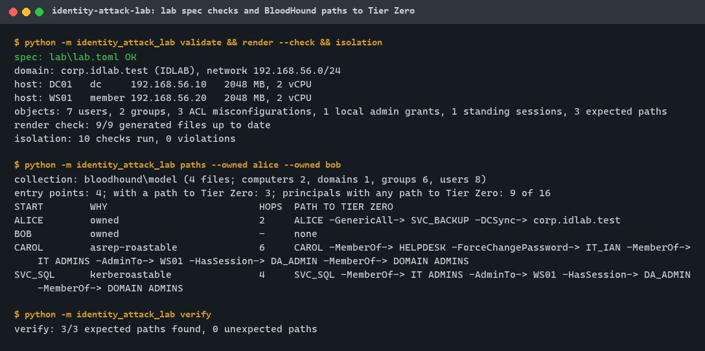
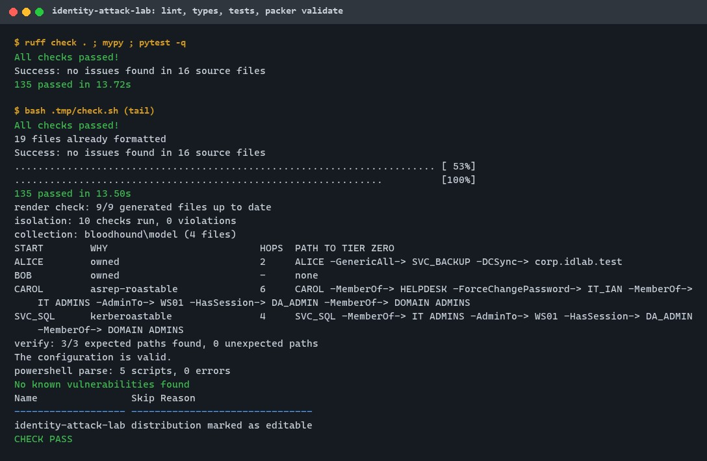
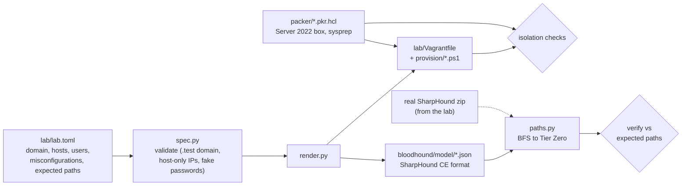
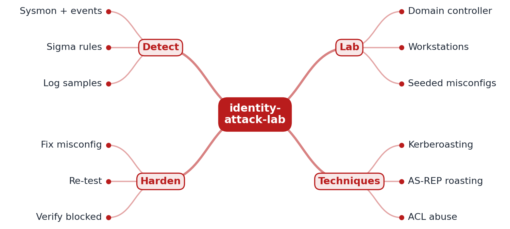

# identity-attack-lab

[](https://github.com/EquinoxWN/identity-attack-lab/actions/workflows/ci.yml)


> A safe home lab for learning to DETECT Active-Directory attacks: reproduce a technique, then write and test the detection that catches it.

Part of my **Cyber Security** list · Python · Packer · Vagrant · PowerShell

> Builds on: [detection-as-code](https://github.com/EquinoxWN/detection-as-code)

## Proof it works

The lab is defined in one file. It is validated, rendered into the Vagrant and PowerShell files and
checked for network isolation. Its BloodHound model then shows the three designed paths to Tier
Zero and no others (`verify` exits 1 on any difference):



Lint, strict types, the 138-test suite and the full local check (Packer validate, PowerShell parse,
dependency audit):



## Architecture

**What M1 runs today:**



**Full roadmap (M1 to M3):**



## How it works

_Steps 1 and 2 are built and tested (M1); the rest is on the [roadmap](#roadmap)._

1. Vagrant and Packer build a small AD domain on your own machine with deliberate misconfigurations; nothing is exposed to the internet.
2. BloodHound CE maps the domain and shows which paths would lead to Domain Admin.
3. Each technique is reproduced in the lab only, documented at the level of the signal it leaves rather than a step-by-step recipe.
4. The Windows and Sysmon events each technique produces are captured as log samples.
5. A Sigma detection is written for each and added to detection-as-code, using those samples as its tests.
6. Each misconfiguration is then fixed and the technique re-run to confirm the detection fires and the hardening holds.

In M1, steps 1 and 2 work like this:

- `lab/lab.toml` lists the domain (`corp.idlab.test`), a DC and a member (WS01), seven users, two
  groups and the misconfigurations: a service account with an SPN, a user without Kerberos
  pre-authentication, three ACL entries (ForceChangePassword, GenericAll, DCSync), a local admin
  grant and a domain admin's standing session on WS01.
- `render` turns it into a Vagrantfile and idempotent PowerShell (forest creation, domain seeding
  with `dsacls`, domain join, local admins, a scheduled task that keeps the admin session) and into
  the JSON files SharpHound CE writes, so BloodHound CE can show the domain before any VM exists.
- `paths` reads a model or a real collection (directory or zip) and prints, for every owned,
  Kerberoastable or AS-REP roastable user, the shortest path into Tier Zero.
- `verify` fails when the paths found differ from the `expected_paths` in the spec.

## Who it helps

- **Who:** Students and blue/purple-team engineers who want an Active Directory lab on their own
  laptop to practise detection, and reviewers who want to read its design without building it.
- **The problem:** Hand-built labs drift: nobody can say which misconfiguration creates which path
  to Domain Admin, VMs end up bridged onto the home network, and tutorial passwords look real.
- **How to use it:** Edit `lab/lab.toml`, run `make render bench`, then build the box with Packer
  and `vagrant up` in `lab/`. Load `bloodhound/model/` (or a SharpHound zip from the lab) into
  BloodHound CE to explore it, and run `python -m identity_attack_lab verify <zip>` to confirm the
  real domain has exactly the designed paths.

## Tech stack

| Area | In M1 | Planned |
|---|---|---|
| Lab build | Packer 1.16.2 (virtualbox-iso, sysprepped Server 2022 box), Vagrant 2.4 + VirtualBox, generated PowerShell | Windows 11 workstation box, Sysmon install (M2) |
| Lab definition | `lab/lab.toml` validated by Python (stdlib only) | More misconfigurations (delegation, ADCS) |
| Attack paths | SharpHound CE JSON model, offline BFS analyzer, BloodHound CE Cypher queries | Live BloodHound CE ingest |
| Detection | | Windows and Sysmon samples (M2), Sigma rules in detection-as-code (M3) |
| Quality | ruff, mypy strict, pytest, pip-audit, packer validate, PowerShell parser, GitHub Actions | |

| Path | What it is |
|---|---|
| `lab/lab.toml` | The single source of truth for the lab |
| `lab/Vagrantfile`, `lab/provision/*.ps1` | Generated: VMs and provisioning (do not edit) |
| `bloodhound/model/*.json` | Generated: the designed domain in SharpHound CE format |
| `bloodhound/queries.cypher` | Saved queries for BloodHound CE |
| `packer/` | Box template, answer files, WinRM bootstrap |
| `src/identity_attack_lab/` | `spec`, `render`, `isolation`, `bloodhound`, `paths`, `cli` |
| `scripts/ps-parse.ps1` | Parses (never runs) every PowerShell script |

## Run it

Needs Python 3.11 or newer. Building the VMs also needs VirtualBox 7, Packer, Vagrant, a Windows
Server 2022 evaluation ISO, about 8 GB of free RAM and 40 GB of disk.

```bash
make setup     # dev tools (the package itself has no runtime dependencies)
make test      # 138 tests
make bench     # render check, isolation checks, path verification, path table
make render    # after editing lab/lab.toml
```

Build the lab (lab only, on your own machine):

```bash
packer init packer/
packer build -var iso_url=file:///path/to/ws2022-eval.iso -var iso_checksum=sha256:<hash> packer/
vagrant box add idlab/windows-server-2022 .tmp/boxes/idlab-ws2022-virtualbox.box
cd lab && vagrant up           # DC01 first, then WS01; host-only network 192.168.56.0/24
```

Collect and check (only against this lab): run SharpHound CE on WS01 or `bloodhound-ce-python`
from the host against `192.168.56.10`, then:

```bash
python -m identity_attack_lab verify path/to/collection.zip
```

`make packer-validate` keeps Packer's plugins in `.tmp/` (`PACKER_PLUGIN_PATH`, `PACKER_CONFIG_DIR`);
the Python code reads no environment variables.

## Tests and results

Latest local run (full detail in [docs/results/m1.md](docs/results/m1.md)): **138 passed, 0 failed**.

| Test file | Tests | What it proves |
|---|---|---|
| `tests/test_spec.py` | 60 | The lab loads; 52 unsafe or inconsistent specs are rejected with the key named (real TLD, public range, bad addresses, real-looking, weak or non-ASCII passwords (including Unicode quotes), wrong right for a target, unknown names) |
| `tests/test_bloodhound.py` | 23 | Model format and flags; committed model gives the 3 designed paths; DCSync needs both rights; disabled users, Tier Zero, local groups; zip, zip-bomb and size limits; 9 malformed files |
| `tests/test_isolation.py` | 19 | Shipped files pass; bridged NICs, off-loopback forwards, missing port overrides, shared folders, GUI builds, open VRDP, unverified ISOs, HTTP server and real-looking passwords are caught |
| `tests/test_paths.py` | 15 | Shortest paths, stable tie-break, no-path and zero-hop cases, reverse exposure, entry points |
| `tests/test_render.py` | 12 | No drift, non-ASCII refused by the renderer too, deterministic and atomic writes, DC first, every misconfiguration rendered, one box password everywhere |
| `tests/test_cli.py` | 9 | Exit codes 0/1/2 for every command; `verify` reports exact mismatches |

| Check | Result |
|---|---|
| Designed paths found in the model | 3/3, 0 unexpected |
| Entry points with a path to Tier Zero | 3 of 4 (alice 2 hops, svc_sql 4, carol 6; bob none) |
| Principals with any path to Tier Zero | 9 of 16 |
| Isolation and fake-secret checks | 10 files, 0 violations |
| Generated files in sync | 9/9 |
| `packer validate` / PowerShell parse | valid / 5 scripts, 0 errors |
| Hand mutations killed | 18/18 |
| `pip-audit` | No known vulnerabilities found |

Not verified yet: a full `packer build` and `vagrant up`, a live BloodHound CE ingest and `verify`
on a real collection. `vagrant validate` and `ruby -c` run only in CI.

Quality check against the 10 engineering rules, with the mutation table:
[docs/quality/2026-11-01.md](docs/quality/2026-11-01.md).

## Roadmap

**M1** (≈8 h)
- [x] Write `docs/rfc/0001-design.md`: problem, goals, non-goals, chosen design
- [x] Vagrant and Packer build a small AD domain on your own machine with deliberate misconfigurations; nothing is exposed to the internet.
- [x] BloodHound CE maps the domain and shows which paths would lead to Domain Admin.

**M2** (≈8 h)
- [ ] Each technique is reproduced in the lab only, documented at the level of the signal it leaves rather than a step-by-step recipe.
- [ ] The Windows and Sysmon events each technique produces are captured as log samples.

**M3** (≈9 h)
- [ ] A Sigma detection is written for each and added to detection-as-code, using those samples as its tests.
- [ ] Each misconfiguration is then fixed and the technique re-run to confirm the detection fires and the hardening holds.
- [ ] Publish the proof below with real numbers

## Proof

What this repo must show before it counts as done:

- A technique-to-detection matrix: each one, the rule that catches it, and the hardening that stops it.

| Result | Value |
|---|---|
| M3 proof above | Not measured yet (M3). Current M1 numbers: see [Tests and results](#tests-and-results). |

## Why it matters

- **Interview angle:** 'Detect and stop an Active Directory attack' in blue/purple-team rounds.
- **Upstream I'm contributing to:** SigmaHQ rules or BloodHound CE: detections and documentation.

## Design docs

- [RFC 0001: design](docs/rfc/0001-design.md)
- [ADR 0001: record architecture decisions](docs/adr/0001-record-architecture-decisions.md)
- [ADR 0002: check paths offline against a model collection](docs/adr/0002-spec-model-as-path-oracle.md)
- [ADR 0003: one sysprepped Windows Server box for every VM](docs/adr/0003-one-sysprepped-server-box.md)
- [M1 results](docs/results/m1.md)

## Scope

This is a learning and portfolio system, not a hosted production service. Everything runs locally:
the VMs sit on a VirtualBox host-only network, forwarded ports bind to 127.0.0.1, the domain uses
the reserved `.test` suffix, and every password contains `EXAMPLE-NOT-A-SECRET`. The repository
contains no attack tooling; the analyzer only reads BloodHound data.

## Security and contributing

- Every GitHub Action is pinned to a commit SHA; workflows run read-only, without persisted
  credentials. Packer and Vagrant are downloaded in CI with pinned versions and SHA-256 checks.
- Dependabot update pull requests are paused (`open-pull-requests-limit: 0`) so the repository
  keeps a single `main` branch; dependencies are updated by hand and checked by the CI audit.
- Report vulnerabilities privately: see [SECURITY.md](SECURITY.md). To contribute, see
  [CONTRIBUTING.md](CONTRIBUTING.md).

## License

MIT, see [LICENSE](LICENSE).
